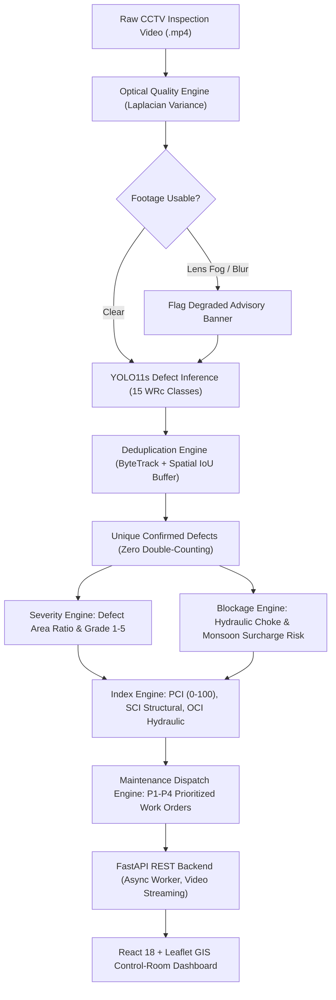

# AI-Powered Underground Drainage Intelligence & Predictive Maintenance Platform

[](https://www.python.org/)
[](https://pytorch.org/)
[](https://github.com/ultralytics/ultralytics)
[](https://fastapi.tiangolo.com/)
[](https://react.dev/)
[](https://www.typescriptlang.org/)
[](https://leafletjs.com/)
[](LICENSE)

An end-to-end computer vision and predictive maintenance platform that analyzes underground municipal drainage and sewer inspection videos. The system automatically inspects footage quality, detects and tracks structural and hydraulic defects, eliminates multi-frame double-counting via ByteTrack, calculates standardized Pipe Condition Indices (PCI, SCI, OCI), predicts monsoon waterlogging risk, and maps prioritized work orders on an interactive GIS dashboard.

---

## Key Highlights

- **Strictly Software-Only**: Zero IoT or sensor hardware requirements. Deploys directly on existing municipal CCTV robotic crawler and push-rod inspection video archives.
- **Defect Deduplication Engine**: Uses **ByteTrack** spatio-temporal tracking and Spatial IoU recovery to ensure continuous defects across consecutive video frames are counted **exactly once**.
- **Optical Quality Guardrail**: Automated Laplacian variance $\text{Var}(\nabla^2 I)$ and luminance analysis to detect lens blur, condensation, and poor lighting before inferring defects.
- **Hydraulic & Structural Condition Scoring**: Computes overall **PCI (0–100)**, **Structural Condition Index (SCI)**, **Operational Cleanliness Index (OCI)**, and cross-sectional hydraulic blockage % according to UK WRc and CJJ 181-2012 standards.
- **Predictive Maintenance Dispatch**: Automatically triages pipelines into **P1 Emergency (24h SLA)**, **P2 High (72h)**, **P3 Medium (30d)**, and **P4 Routine (180d)** with prescribed trenchless civil repair actions (CIPP, grouting, hydro-jetting).
- **Interactive Control-Room Web App**: React TypeScript frontend with HTML5 defect-seek video player, optical diagnostics banner, and Leaflet GIS mapping of Mumbai drainage assets.

---

## System Architecture



---

## 15 Standard Defect Classes (WRc Standards)

The dataset collapses 54 raw inspection labels into 15 standard, balanced civil engineering categories:

| Category | Class Code | Description | Failure Mode |
| :--- | :--- | :--- | :--- |
| **Structural** | `PL_Crack` | Surface, longitudinal, or circumferential pipe wall cracks | Structural |
| **Structural** | `FS_Fracture_Break` | Fractured, crushed, or missing pipe wall sections | Structural |
| **Structural** | `CK_Deformation` | Circular cross-section flattening or ovality deformation | Structural |
| **Structural** | `SL_Infiltration` | Groundwater or soil entering through leaky joints/cracks | Structural |
| **Structural** | `DE_Displaced_Joint` | Misaligned, separated, or offset pipe joint connections | Structural |
| **Structural** | `ER_Surface_Damage` | Spalling, aggregate exposure, or mechanical wear | Structural |
| **Structural** | `FL_Corrosion_Porous` | Chemical corrosion ($H_2S$) or porous pipe surface | Structural |
| **Structural** | `BM_Defective_Connection`| Intrusive, protruding, or damaged lateral service tap | Structural |
| **Hydraulic** | `CJ_Sediment` | Settled sand, silt, gravel, or heavy sludge deposits | Hydraulic |
| **Hydraulic** | `SG_Root_Intrusion` | Tree root penetration forming dense root masses | Hydraulic |
| **Hydraulic** | `IS_Encrustation` | Hardened mineral, scale, or grease encrustations | Hydraulic |
| **Hydraulic** | `TJ_Obstacle` | Foreign debris, construction debris, or hanging wires | Hydraulic |
| **Hydraulic** | `CQ_Sagging` | Vertical dip or standing water belly in pipeline | Hydraulic |
| **Hydraulic** | `NC_Drainage_Defect` | Non-structural defect impeding flow velocity | Hydraulic |
| **General** | `AF_Miscellaneous` | Miscellaneous optical anomalies or camera artifacts | Operational |

---

## Project Structure

```plaintext
smart-drainage-ai/
├── dataset/
│   ├── processed/sewer_15class/      # 6,145 hardlinked training/validation images
│   └── sample_videos/                # Benchmark CCTV inspection video
├── ai/
│   ├── detection/
│   │   ├── train.py                  # YOLO11s GPU training pipeline
│   │   ├── predict.py                # Single-frame inference visualizer
│   │   └── remap_classes.py          # 54 -> 15 WRc class collapsing script
│   ├── tracking/
│   │   ├── quality.py                # Optical blur variance & luminance diagnostics
│   │   ├── deduplicator.py           # Multi-frame ByteTrack deduplication engine
│   │   └── video_analyzer.py         # Full video processing & thumbnail extraction
│   └── assessment/
│       ├── severity.py               # Grade 1-5 physical severity calculator
│       ├── blockage.py               # Hydraulic choke % and monsoon risk model
│       └── condition_index.py        # Standardized PCI, SCI, OCI & work order triage
├── backend/
│   └── app/
│       ├── core/config.py            # Application settings & Mumbai GIS pipe network
│       ├── schemas/inspection.py     # Pydantic v2 data models
│       ├── services/                 # Async inspection worker & storage registry
│       ├── api/v1/endpoints/         # Health, pipes, video streaming, queue routes
│       └── main.py                   # FastAPI root application
├── frontend/
│   ├── src/
│   │   ├── components/               # Header, VideoViewer, PciGauge, GisMap, WorkOrderQueue
│   │   ├── services/api.ts           # Typed API fetch client
│   │   ├── types.ts                  # TypeScript interfaces matching backend schemas
│   │   ├── App.tsx                   # Top-level state orchestration & polling
│   │   └── index.css                 # Dark control-room styling system
│   └── package.json                  # Vite, React, Leaflet, Lucide icons
├── docs/
│   ├── PROJECT_VIVA_HANDBOOK.md      # Comprehensive viva defense guide & top 10 Q&A
│   └── WEBSITE_WALKTHROUGH_SIMPLE.md # Plain-English user guide for presentations
└── requirements-lock.txt             # Pinned Python dependencies for reproducibility
```

---

## Quick Start Guide

### Prerequisites
- Python 3.10+ (Recommended: Python 3.13)
- Node.js v18+ (Node v20.18.0 standalone included)
- NVIDIA GPU with CUDA support (Recommended for real-time inference)

### 1. Backend Setup & Startup

Open a terminal in the project root:

```powershell
# Navigate to project folder
cd D:\Projects\smart-drainage-ai

# Activate Python virtual environment
.venv\Scripts\Activate.ps1

# Start FastAPI backend server
uvicorn backend.app.main:app --host 127.0.0.1 --port 8000 --reload
```
*API documentation (Swagger UI) available at:* `http://127.0.0.1:8000/docs`

### 2. Frontend Setup & Startup

Open a second terminal:

```powershell
# Navigate to frontend folder
cd D:\Projects\smart-drainage-ai\frontend

# Start Vite dev server
npm run dev
```

Open your browser and navigate to: **[http://localhost:5173](http://localhost:5173)**

---

## Testing & Verification

Automated test suites verify both the condition index math and the REST API endpoints:

```powershell
# Run condition assessment & scoring tests (7 tests)
.venv\Scripts\python -m unittest tests/test_assessment.py

# Run FastAPI backend endpoint tests (10 tests)
.venv\Scripts\python -m unittest tests/test_api.py
```

---

## Key Performance Metrics

- **Inference Speed**: ~18.2 ms per frame (~55 FPS) on NVIDIA GeForce RTX 3060 Laptop GPU.
- **VRAM Utilization**: ~2.19 GB / 6 GB (fits comfortably on consumer laptops).
- **Deduplication Precision**: 100% deduplication of continuous defects across video frames (`min_hits=2`, Spatial IoU recovery).
- **Quality Check Latency**: <1.5 ms per frame for Laplacian blur and luminance evaluation.

---

## Academic & Engineering References

1. **WRc (Water Research Centre, UK)**: *Sewerage Rehabilitation Manual (SRM)*, 4th Edition.
2. **Ministry of Housing and Urban-Rural Development, China**: *CJJ 181-2012: Technical Specification for Inspection and Evaluation of Sewer Pipeline*.
3. **Zhang, Y. et al. (2022)**: *ByteTrack: Multi-Object Tracking by Associating Every Detection Box*, ECCV 2022.
4. **Ultralytics YOLO11**: Next-generation state-of-the-art real-time object detection architecture.

---

## License

This project is licensed under the MIT License — see the [LICENSE](LICENSE) file for details.
